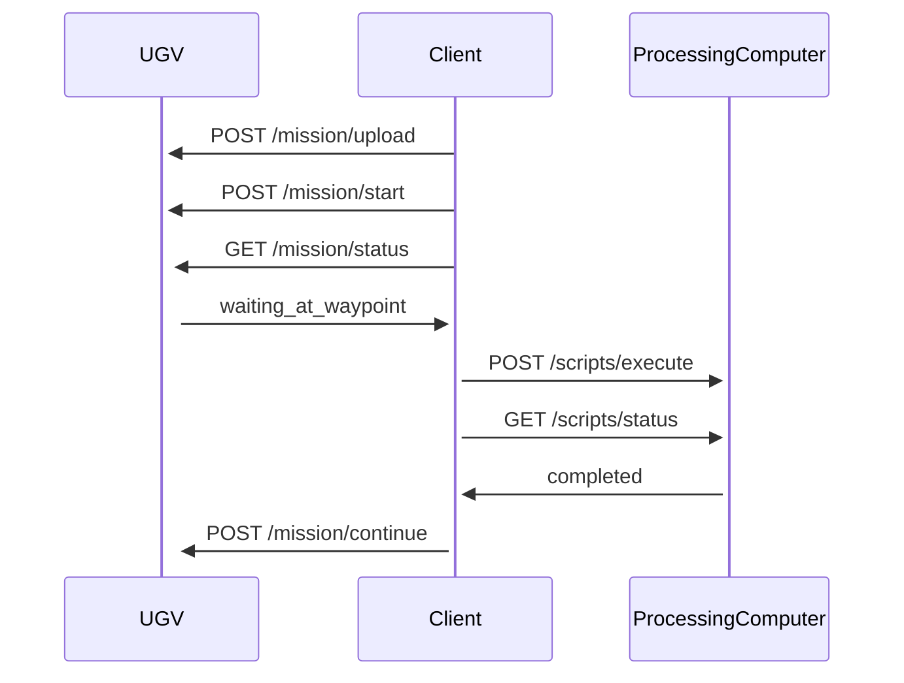

# Processing Computer Integration

## Architecture
* UGV Bridge stays on port `:8000`.
* Mirrored FastAPI service on the Processing Computer on different port e.g: `:8001`.
* Both services rely on identical YAML files placed localy on Client Computer and Processing Computer.
* YAML files define scripts IDs for GUI integration to local file paths and CLI arguments for Processing Comptuer.
* The Processing Computer facilitates `subprocess.run()` script calls inside a background worker thread. This require a running `ScriptOrchestrator` on Processing Computer.

## Bridge extensions
* Processing Computer
    * `POST /scripts/execute` - Accepts a JSON list of script IDs, validates them againt `scripts_config.yaml`.
    * `GET /scripts/status` - Returns execution state, active script name, and error logs.
* Client Computer
    * Class for direct communication with Processing Computer.
    * Adjustments of currently working classes.
## Example workflow:

